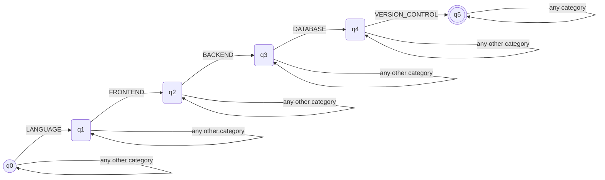
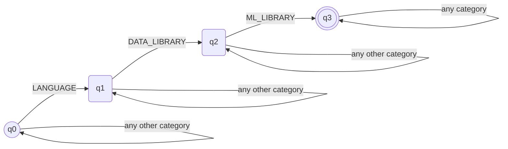
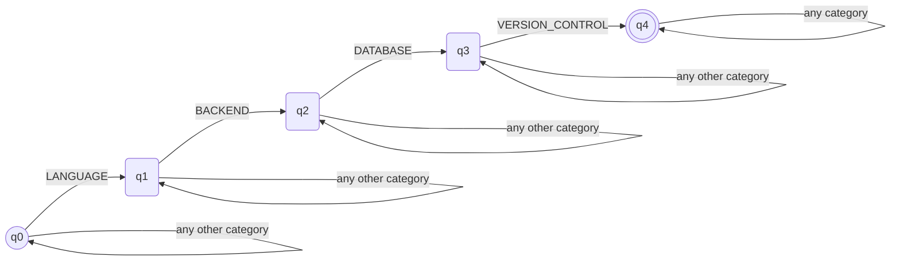
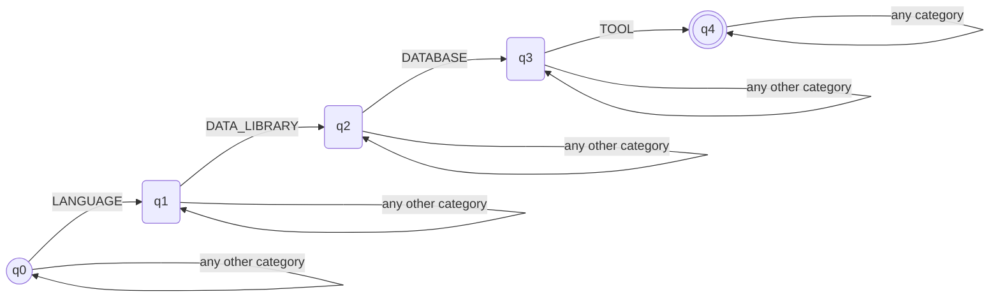

# Stage 3 - Classification: the four automata (5-tuples and diagrams)

Implementation: `src/classification/automata.py` (`pyformlang`). Diagrams and
counts: `src/classification/diagrams.py` (generated, like
`src/normalization/diagrams.py` does for stage 2 - a test compares these
blocks against the code, so they cannot go out of date). Design rationale
and the required-categories table: [classification-design.md](classification-design.md).

## Shared model

Every profile's automaton is a DFA built by `automata.build_automaton`:
a "required categories seen so far" counter over `Σ = vocabulary.Category`
(all nine categories, the same set for every profile). State `qi` means the
first `i` required categories, in the profile's order, have already
appeared; the only accepting state is `qk`, `k = len(required)`.

| | |
|---|---|
| **Type** | Deterministic finite automaton (DFA) |
| **Why DFA, not NFA/NFA-λ** | `δ(qi, c)` is defined for every state and every symbol, with exactly one result: the next pending required category advances the state, anything else self-loops. There is never a choice between two transitions on the same symbol, so no NFA-style branching is needed - see [classification-design.md](classification-design.md) section 1. |
| **Σ (every automaton)** | `{LANGUAGE, FRONTEND, BACKEND, DATABASE, VERSION_CONTROL, ML_LIBRARY, DATA_LIBRARY, CONCEPT, TOOL}` |

## Counts

<!-- generated by `python -m src.classification.diagrams counts` -->
| Automaton | \|Q\| | \|Σ\| | \|δ\| | \|F\| |
|---|---|---|---|---|
| full_stack_developer | 6 | 9 | 54 | 1 |
| machine_learning_engineer | 4 | 9 | 36 | 1 |
| backend_developer | 5 | 9 | 45 | 1 |
| data_scientist | 5 | 9 | 45 | 1 |

Every automaton is total (`|δ| = |Q| × |Σ|`), which is what makes it a DFA
by construction rather than something checked after the fact.

## FULL_STACK_DEVELOPER

- **Q** = `{q0, q1, q2, q3, q4, q5}`
- **Σ** = the nine categories (shared, above)
- **δ**: `q0 -LANGUAGE-> q1`, `q1 -FRONTEND-> q2`, `q2 -BACKEND-> q3`,
  `q3 -DATABASE-> q4`, `q4 -VERSION_CONTROL-> q5`; every other
  `(state, category)` pair self-loops
- **q0** = `q0`
- **F** = `{q5}`
- **Pattern represented**: the required technology groups the assignment
  lists for this role - a language, a frontend framework, a backend
  framework, a database, and version control. `CONCEPT` (e.g. REST API) is
  read but optional.

<!-- generated by `python -m src.classification.diagrams full_stack_developer` -->

## MACHINE_LEARNING_ENGINEER

- **Q** = `{q0, q1, q2, q3}`
- **Σ** = the nine categories (shared, above)
- **δ**: `q0 -LANGUAGE-> q1`, `q1 -DATA_LIBRARY-> q2`,
  `q2 -ML_LIBRARY-> q3`; every other `(state, category)` pair self-loops
- **q0** = `q0`
- **F** = `{q3}`
- **Pattern represented**: the assignment's core list for this role -
  a language, a data-processing library and an ML framework. `DATABASE`,
  `VERSION_CONTROL` and `CONCEPT` are read but optional.

<!-- generated by `python -m src.classification.diagrams machine_learning_engineer` -->

## BACKEND_DEVELOPER (team-defined, provisional)

- **Q** = `{q0, q1, q2, q3, q4}`
- **Σ** = the nine categories (shared, above)
- **δ**: `q0 -LANGUAGE-> q1`, `q1 -BACKEND-> q2`, `q2 -DATABASE-> q3`,
  `q3 -VERSION_CONTROL-> q4`; every other `(state, category)` pair
  self-loops
- **q0** = `q0`
- **F** = `{q4}`
- **Pattern represented**: the same server-side stack as
  `FULL_STACK_DEVELOPER`, minus `FRONTEND` - the one category that tells
  the two roles apart (a résumé with only `FRONTEND` instead of `BACKEND`
  is rejected; see `tests/test_classification_backend.py`). `CONCEPT` and
  `TOOL` are read but optional.

<!-- generated by `python -m src.classification.diagrams backend_developer` -->

## DATA_SCIENTIST (team-defined, provisional)

- **Q** = `{q0, q1, q2, q3, q4}`
- **Σ** = the nine categories (shared, above)
- **δ**: `q0 -LANGUAGE-> q1`, `q1 -DATA_LIBRARY-> q2`,
  `q2 -DATABASE-> q3`, `q3 -TOOL-> q4`; every other `(state, category)`
  pair self-loops
- **q0** = `q0`
- **F** = `{q4}`
- **Pattern represented**: data analysis and tooling (e.g. Jupyter) rather
  than production ML frameworks, so the pattern does not collapse into
  `MACHINE_LEARNING_ENGINEER` (a typical ML Engineer résumé, with no
  `DATABASE` or `TOOL`, is rejected here; see
  `tests/test_classification_data_scientist.py`). `ML_LIBRARY` and
  `VERSION_CONTROL` are read but optional.

<!-- generated by `python -m src.classification.diagrams data_scientist` -->

